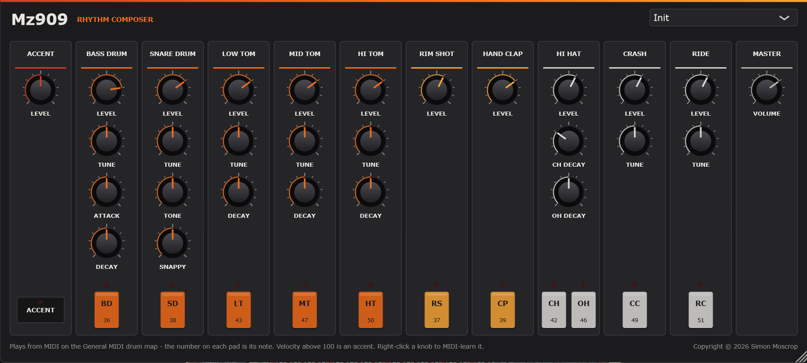

# Mz909

**A TR-909 for your DAW.** Mz909 is a VST3 instrument, and a standalone app, that emulates
the Roland TR-909 Rhythm Composer of 1983: the punchy kick, crisp snare and clap, and
gritty hats and cymbals behind house, techno and a good deal else.

The 909 is half analog, half digital, and Mz909 is built the same way:

- **The drums are circuits.** The bass drum, snare, toms, rim shot and clap are modelled
  as the hardware makes them: a trigger pulse starts an oscillator or opens a VCA.
  - **The kick** is a VCO whose pitch falls from several times its body's 50 Hz. TUNE sets
    how far and for how long, and ATTACK sets the beater's click.
  - **The snare** is two VCOs and a noise source. Its noise outlasts its body.
  - **Every hit starts the same way,** because each hit restarts the oscillators.
- **The metal is samples.** The hats, crash and ride are 6-bit recordings in ROM, read out
  on their own clock into a 6-bit DAC, as on the hardware. The coarse 6-bit steps are kept,
  and so is the way TUNE plays a cymbal faster and shorter.
- **Accent as the 909 does it:** a harder strike, not a volume boost. An accented kick
  sweeps from higher, and the drums drive their output stages harder.
- **The hats share one DAC and one VCA,** so a closed hat chokes an open one.

**The samples are stand-ins.** Roland's recordings are Roland's, so Mz909's ROMs hold
hihat, crash and ride sounds synthesized for it, shaped to measurements of a 909-style
machine. They are stored and played exactly as the 909 stores and plays its own, but they
are not the 909's recordings. See [Not the original samples](#not-the-original-samples).

Every knob of the original panel is here, laid out as on the 909. On top of that:
- **Pads.** Eleven pads play each sound and light up whenever it is struck, from the pad,
  the host or a controller.
- **MIDI control.** Every knob has a MIDI CC. Right-click any knob to MIDI-learn your own.
- **Hover hints.** Hover over any control to see what it does and which CC moves it.
- **Nine factory kits,** from *House* and *Techno* to *Deep Toms*. Your own settings are
  saved with your project.

The sequencer isn't here yet. Program your patterns in the DAW, or play the sounds from a
pad controller.

Mz909 is an independent project. Roland and TR-909 are Roland's trademarks.

## Installing

Mz909 is built from source for now: see [Building](#building). The build installs the VST3
into your per-user plugin folder, `%LOCALAPPDATA%\Programs\Common\VST3`. Most DAWs find it
there. Some need the folder added to their plugin paths once; in Ableton Live it goes under
*Preferences → Plug-Ins → VST3 Plug-In Custom Folder*.

The standalone app, `Mz909.exe`, plays without a DAW. Its *Options* button chooses the audio
and MIDI devices.

### macOS (beta)

Download `Mz909-<version>-macOS-beta.zip` from the
[releases page](https://github.com/simozzer/Mz909/releases) and unzip it. It holds the VST3, an Audio Unit (for Logic and GarageBand) and the standalone app,
for Apple Silicon and Intel Macs on macOS 11 or later.

They aren't signed by Apple, which takes a paid developer account, so macOS won't open them
with a double-click. Install them from Terminal instead. Type `bash ` (with the space), drag
`install.sh` from the unzipped folder into the Terminal window, and press Return:

    bash ~/Downloads/Mz909-<version>-macOS-beta/install.sh

It copies everything into your own Library folders, with no password needed, and clears the
"downloaded from the internet" flag that would stop your DAW loading the plugin. Then rescan
plugins in your DAW. `READ ME FIRST.txt` in the zip explains how to install by hand instead.

It's a beta: built and checked on GitHub's Macs, including Apple's own Audio Unit validator,
but not yet tried on a real one. If something doesn't work, please
[open an issue](https://github.com/simozzer/Mz909/issues).

## Building

Needs Visual Studio 2022+ with *Desktop development with C++*, and JUCE checked out beside
this repository (`..\JUCE`, or pass `-DJUCE_PATH=`).

    .\build.ps1                 engine check, then the VST3 and the standalone
    .\build.ps1 -NoPlugin       engine check only
    .\build.ps1 -Wav out        and render demo patterns into out\ to listen to
    .\build.ps1 -Release        and the files a release attaches, into dist\

`-Release` also needs [Inno Setup 6](https://jrsoftware.org/isdl.php). It writes:
- `Mz909-<version>-win64-Setup.exe`: installs the VST3, the standalone or both, for
  everyone or just the current user, with an uninstaller.
- `Mz909-<version>-win64-VST3.zip` and `Mz909-<version>-win64-Standalone.zip`: for
  installing by hand, each with a README.

The version comes from `project()` in `CMakeLists.txt`. Change it there, and the binaries,
installer and file names all follow.

**Releasing.** Bump the version, write the notes in `docs/releases/v<version>.md`, then push
a matching tag (`git push origin v0.2.0`). The release workflow builds and checks everything
on GitHub, and attaches the installer and zips to a draft release with those notes, ready to
read over and publish. It refuses a tag that disagrees with `CMakeLists.txt`. It then reads
the release back from GitHub and fails unless the installer and both zips are on it. If it
fails, fix the cause and run the *release* workflow again from the Actions tab with the tag.
Once the Windows job has made the draft, a Mac job adds `Mz909-<version>-macOS-beta.zip` to it
(`.github/workflows/mac.yml`, which also runs on every push to `main` as a check).

## Layout

    Source/TR909/        the instrument - plain C++, no JUCE
      Dsp.h              filters, noise, the curves of the pots
      Trigger.h          the trigger pulse, accent, envelope generators
      Vco.h              the drum oscillator the analog voices are built from
      BassDrum.h  SnareDrum.h  Toms.h  RimShot.h  HandClap.h
      Rom.h              the 6-bit ROMs, and the counter and DAC that play them
      Roms.cpp           what is in the ROMs: stand-ins, generated from noise and sines
      RomProfiles.h      the measured descriptions the stand-ins are shaped to
      HiHat.h  Cymbal.h  the sampled voices
      Engine.h/.cpp      the note map, the shared circuits, the mixer
      Settings.h         the front panel, in panel units
    Source/              the JUCE plugin round it: parameters, kits, editor
    Tests/DspCheck.cpp   the engine's checks; gates the plugin build

## How it works

**Trigger and accent.** The CPU strikes each instrument with a 1 ms trigger pulse. An
accented step is a taller pulse: the ACCENT knob sets it between 1× and 2× the plain one.
Each voice makes its envelopes, and the analog ones their pitch sweeps, from that pulse.
So an accent changes the sound as well as the level.

**The drum oscillator.** Where the 808 rings a resonator, the 909's drums each run a VCO.
Its triangle is rounded by a transistor shaper into a near-sine. The corners stay a little
pointed, which helps a 909 kick cut through where an 808's booms. Every hit restarts it from
the same point, so every hit starts the same way.

**Bass drum (TUNE, ATTACK, DECAY).**
- **The sweep.** A pitch envelope starts the VCO several times above its body's 50 Hz and
  lets it fall exponentially. TUNE sets how far and how long: a short, tight drop at 0, a
  long, deep sweep at 10.
- **ATTACK** is the beater: the trigger's edge, differentiated into a click, and a puff of
  low-passed noise.
- **DECAY** is the VCA's envelope, about 0.3 s to 2 s to −40 dB.
- **The output stage** saturates softly, so an accent's deeper sweep and harder push punch
  rather than just getting louder.

**Snare (TUNE, TONE, SNAPPY).** Two VCOs at about 185 and 330 Hz, each on its own VCA, both
starting a little sharp. TUNE moves them together. The snares are white noise, low-passed
and high-passed, on an envelope longer than the head's. SNAPPY sets its level and TONE its
brightness.

**Toms (TUNE, DECAY).** Built like the kick, smaller: a VCO whose pitch drops as it strikes,
a VCA on DECAY, and a little noise for the stick. Nominal pitches are 100, 140 and 200 Hz;
TUNE moves each half an octave either way.

**Rim shot.** The 808's, carried over and sharpened: two resonators at about 500 Hz and
1.7 kHz, kicked by the shaped trigger, through an overdriven VCA on a very short envelope,
then a high pass.

**Hand clap.** White noise through a band pass a little above 1 kHz, opened by a burst of
quick decays a few milliseconds apart, then a slower "reverb" tail.

**The ROMs.** The hats, crash and ride are 6-bit samples, 64 levels, read by a counter on
the ROM's own clock (48 kHz at TUNE's centre) into a 6-bit DAC.
- **The DAC** holds each sample until the next, so its output is a staircase. Each step is
  placed at its exact sub-sample time and band-limited there, with a 32-point filter flat to
  about 0.42 of the host's sample rate. The stairs are kept, and almost nothing above the
  host's Nyquist folds back. This delays the hats and cymbals by 16 samples (0.33 ms at
  48 kHz).
- **Hihats (LEVEL, CH DECAY, OH DECAY).** Each hat has its own sample, restarted by each hit,
  but they share one DAC and one VCA. Which hat was struck decides whether the VCA's
  envelope lets go through CH DECAY or OH DECAY, so a closed hat chokes an open one.
- **The hats' VCA has a threshold.** Its envelope falls as an RC curve, but the gain is
  only what is left above the threshold. So a hat holds, then falls faster and faster, and
  stops dead. CH DECAY 5 and OH DECAY 10 are the settings the measured hats were recorded
  at; those are the defaults.
- **Crash and ride (LEVEL, TUNE).** Each plays its own sample to the end, just under a
  second. The decay is in the recording, so there is no DECAY knob. TUNE is the ROM's
  clock, a little over half an octave either way: faster is higher and shorter together,
  as on the hardware.
- **Accent** on the metal is a louder hit through the VCA after the DAC, up to +10 dB at full
  ACCENT. That is what an accent measured on the 909-style machine, with no change in
  brightness.

**Mixer.** Each sound's LEVEL is an audio-taper pot, the hats' shared. A coupling capacitor
and the master VOLUME follow. Sounds that have rung out are put to sleep, so an idle Mz909
costs almost nothing. All eleven playing every 16th uses about 2.5% of one core.

## MIDI

Every MIDI channel plays. Notes follow the General MIDI drum map. Velocity **above 100** is
an accent; 100 and below plays unaccented, so notes drawn at most hosts' default of 100 stay
plain. Velocity does nothing else: like the hardware, a hit is either accented or not.
Note-offs are ignored, because every 909 sound runs out on its own.

| Sound | Note | | Sound | Note | | Sound | Note |
|---|---|---|---|---|---|---|---|
| Bass drum | 36 (and 35) | | Low tom | 43 (and 41) | | Closed hihat | 42 (and 44) |
| Rim shot | 37 | | Mid tom | 47 (and 45) | | Open hihat | 46 |
| Snare | 38 (and 40) | | Hi tom | 50 (and 48) | | Crash | 49 (and 52, 55, 57) |
| Hand clap | 39 | | | | | Ride | 51 (and 53, 59) |

Every knob has a fixed CC, in panel order, from MIDI's undefined numbers. A CC moves the
knob itself, so the panel follows and the host can record it.

| Control | CC | | Control | CC | | Control | CC |
|---|---|---|---|---|---|---|---|
| Accent | 14 | | Low tom level | 23 | | Rim shot level | 102 |
| Bass drum level | 15 | | Low tom tune | 24 | | Hand clap level | 103 |
| Bass drum tune | 16 | | Low tom decay | 25 | | Hihat level | 104 |
| Bass drum attack | 17 | | Mid tom level | 26 | | Closed hihat decay | 105 |
| Bass drum decay | 18 | | Mid tom tune | 27 | | Open hihat decay | 106 |
| Snare level | 19 | | Mid tom decay | 28 | | Crash level | 107 |
| Snare tune | 20 | | Hi tom level | 29 | | Crash tune | 108 |
| Snare tone | 21 | | Hi tom tune | 30 | | Ride level | 109 |
| Snare snappy | 22 | | Hi tom decay | 31 | | Ride tune | 110 |
| | | | | | | Volume | 7 |

The table lives in `Source/Params.cpp`. Each control's CC, hover hint and saved state are
defined there together.

**MIDI learn.** Right-click any knob (or its label) to open its menu:
- **MIDI Learn:** the knob is outlined in red until a CC arrives, and that CC is assigned
  to it. Right-click again to cancel.
- **Forget CC:** the knob stops answering to MIDI.
- **Restore default:** puts back the CC from the table above.
- **Reset all CCs to defaults.**

Each CC drives one knob at a time. CCs 0 and 32 (bank select) and 120 and up (channel mode)
can't be learned. Assignments are saved with the project.

## Not the original samples

The 909's hats, crash and ride are recordings, and those recordings belong to Roland. Mz909
does not include them, or anyone else's. Its ROMs hold stand-ins, generated when Mz909 starts
from white noise and sine waves.

**How the stand-ins were voiced.** Each is shaped to a description measured from
recordings of a Behringer RD-9, a 909-style machine whose hats and cymbals are also 6-bit
samples. The description is numbers, in `Source/TR909/RomProfiles.h`:
- the energy in 18 frequency bands at about 35 moments through the sound;
- its first 40 ms, a millisecond at a time;
- the steady pitches in it, with how far each stands above the noise early, in the middle
  and late.

No audio was kept, and the generator only shapes its own noise and sines to fit, so the
measured sounds cannot be rebuilt from the description. For the hats, the RD-9's VCA was
divided back out of the measurements, so Mz909's own VCA and DECAY knobs shape them. The
engine check holds each ROM to its description, within 2-3 dB across bands and time.

They are Mz909's metal, voiced to sound like that machine's. They are not the 909's own
recordings, which are what a 909 would really sound like.

## Calibration

The hats, crash and ride are fitted to measurements of a 909-style machine (see above).

Everything else is the 909's structure, but its numbers are reasoned from that structure
and from the sound, not measured from a real TR-909:

- pitches, sweep depths and times
- envelope and decay times
- filter corners and Qs
- the clap's timing
- the knobs' ranges
- the levels between voices

The next step towards "as close as possible" is to measure a real unit and fit these
numbers. Each is a single named constant in its voice's header.

## Not yet built

- **The sequencer.** The 909's 16-step pattern sequencer, with its shuffle, flam, and
  per-step accents.
- **Individual outputs.** The hardware has an output per instrument; Mz909 mixes to one
  for now.

## Licence

Created by Simon Moscrop.

Mz909 is free software: you can redistribute it and/or modify it under the terms of the GNU
Affero General Public License as published by the Free Software Foundation, version 3. It
is distributed in the hope that it will be useful, but WITHOUT ANY WARRANTY; without even
the implied warranty of MERCHANTABILITY or FITNESS FOR A PARTICULAR PURPOSE. See
[LICENSE](LICENSE) for the full terms.

It is built with [JUCE](https://juce.com), used under the same licence.
